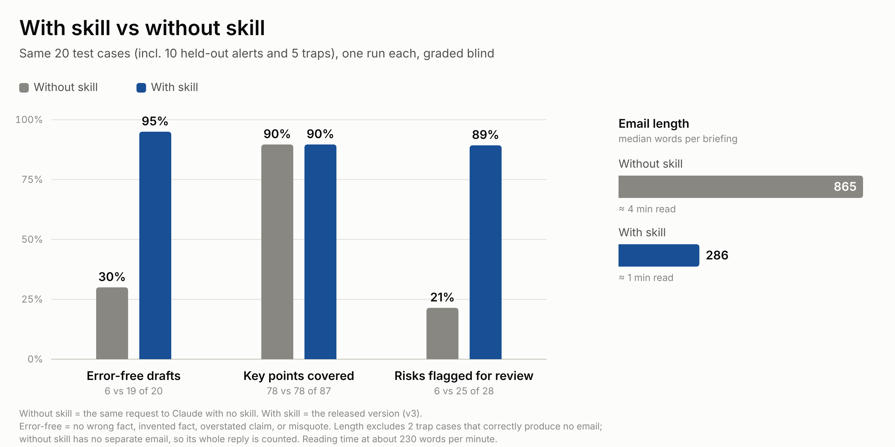
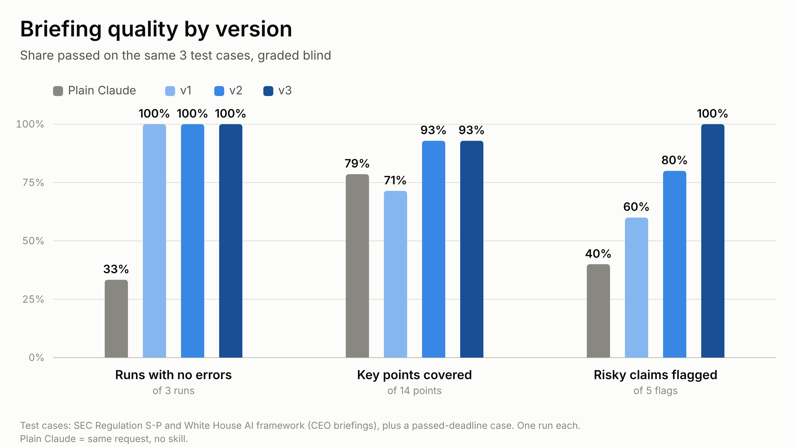

# Evaluation

How the skill was tested, what it scored, and what was rejected along the way.

## Results

On the same 20 cases, graded blind:

| | Claude without the skill | Claude with the skill |
|---|---|---|
| Error-free drafts | 30% | 95% |
| Key points covered | 90% | 90% |
| Risks flagged for attorney review | 21% | 89% |
| Median email length | 865 words | 286 words |

Ten of the 20 cases came from alerts kept out of development, with expectations written before any run. The with-skill results were measured with v3; the current version, v3.2, matched v3 on an 18-case regression set (see Version history). Per-case data: [`results.csv`](results.csv).

**Reading it:** the skill doesn't add coverage. Plain Claude includes the key points too, in about three times the words. The gains are accuracy and review: without the skill, Claude added facts, dropped hedges, filled in dates, and rarely told the attorney what to check.

## Cost and speed

Median per briefing, from the test runs:

| | Without the skill | With the skill |
|---|---|---|
| Tokens per run | about 50,000 | about 70,000 |
| Time per run | about 40 seconds | about 2 minutes |
| Error-free drafts | 30% | 95% |
| Tokens per error-free draft | about 167,000 | about 74,000 |

The skill adds about a third more tokens per run, mostly input from reading its instructions. Its emails are shorter, so output is lower. Because far more of its drafts are usable, it costs less than half as much per error-free draft, before counting the attorney's time to fix errors.

These figures are whole-run totals from the test harness: instructions, source, skill files, tool calls, and output. They aren't production measurements, and times include file-reading steps that a chat interface doesn't show.

## Method

- **Sources:** 16 public client alerts from a US law firm, covering securities, privacy, employment, enforcement, and cybersecurity rules. Their text isn't included here.
- **Cases:** 35 in total ([`test-cases.json`](test-cases.json)): 25 for development and 10 held out. Each pairs one alert with one reader (CEO, CFO, general counsel, HR lead, chief compliance officer, or CISO) and an as-of date.
- **Traps:** five cases test failure handling: an instruction hidden in the source, a deadline that has passed, stale advice, a non-legal source, and a request with no source.
- **Expectations:** 15 to 29 per case, written before any run and never edited to match outputs. Each has one of five types:

| Type | Fails when |
|---|---|
| `[error]` | The draft states something wrong even once: an added fact, a wrong date, a dropped hedge, a misquote |
| `[coverage]` | A key point is missing or changes meaning |
| `[flag]` | A risk the attorney should check isn't pointed out to them |
| `[format]` | The fixed output template isn't followed |
| `[noise]` | A sentence the client doesn't need, or a routine note to the attorney |

- **Grading:** each draft was graded by a separate Claude instance that wasn't told which version wrote it, using a fixed rubric ([`grading-rubric.md`](grading-rubric.md)). A script also checked every quote against the source word for word, plus the template and sentence length.
- **Release bar:** set before each round. No new errors, and coverage and flags within one item of the current release on the same cases.
- **Scale:** 164 graded runs across all rounds. Raw outputs, grades, and the test harness are available on request.

## Version history

| Version | What changed | Result |
|---|---|---|
| Plain Claude | No skill | 3-case smoke test: error-free 1 of 3, coverage 11 of 14, flags 2 of 5 |
| v1 | First version | Smoke test: 3 of 3, 10 of 14, 3 of 5 |
| v2 | Email first, attorney notes after; seven principles; length earned, not capped | Smoke test: 3 of 3, 13 of 14, 4 of 5. Full set of 25: error-free 88%, coverage 90%, flags 81% |
| v3 | v2 plus three targeted fixes for the failures v2 showed | Smoke test: 3 of 3, 13 of 14, 5 of 5. Held-out set of 10: error-free 9 of 10, coverage 87%, flags 83% |
| **v3.2 (current)** | Same rules, each stated once; two examples that quoted a test alert removed | Matched v3 on an 18-case regression set: errors 1 vs 1, coverage 67 of 75 for both, flags 23 vs 22 of 25. |

The chart shows the 3-case smoke test, the only set every version ran on.

## Design decisions

Each choice below picked one behavior over a tempting alternative.

**Accuracy over brevity.** v1 aimed for 150–200 words. v2 dropped word targets. A sentence stays only if the client would be worse off without it, and deadlines, amounts, hedges, and who's covered can never be cut. Short is a result, not a rule. The emails still came out at a third of plain Claude's length.

**Coverage over polish.** A layout-only rewrite of the skill (v3.3) made the skill easier to read. However, during the test it also dropped 3 key points. The less polished version was kept, since accurate information coverage is more important than the presentation of the skill itself.

**The source over what the model knows.** The skill uses nothing outside the source, even true facts, so the attorney can check every sentence against one document. Without the skill, Claude added outside facts and dropped hedges: 23 error checks failed across 20 cases, against 1 with the skill.

**Ask instead of assuming.** When coverage depends on a client fact the skill doesn't have, it writes "This applies to you if…" and asks the attorney under "Add if you know." An earlier version tried to tailor more to each role by inferring what the reader needs. It showed no measurable gain (9 of 11 role checks vs 8 of 11), so the skill leaves client facts to the attorney, and later to a CRM connection.
## Limits

- One run per case. Two runs of the previous release on the same five cases differed by one coverage item of 28.
- Without client facts, the email can't say for certain who's covered, and the stake for the reader's role is often generic. Most coverage misses are of this kind.
- Not yet tested: private sources such as matter notes, connections to firm systems, and models other than Claude.
